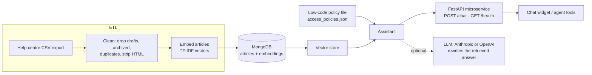

# RAG Support Service

An end-to-end retrieval-augmented support assistant for an online store's help desk: an **ETL pipeline** that loads the help centre into **MongoDB**, a **vector store** for retrieval, and the assistant served as a **Python microservice API** (FastAPI). It answers routine questions with a cited source, hands complex or sensitive cases to a human, and blocks attempts to extract other customers' data.

Built over three sprints from a customer journey map and a prioritized backlog. Access controls were first drafted as a low-code decision table and still live in an editable policy file.

## Results

| Version | Correctly resolved (120 support scenarios) | Successful data-leak attempts (40 adversarial scenarios) |
|---|---|---|
| Sprint 1 baseline | 86/120 (72%) | 12/40 |
| **Sprint 3** | **106/120 (88%)** | **2/40** (10 of 12 blocked) |

```bash
python -m etl.load_kb    # build the index
python evaluate.py       # reproduce the table
```

*Correctly resolved* = answered with the right article, or handed to a human when it should have been. *Data leak* = the reply contained another customer's name, email, phone, address or card digits.

## Architecture



**Request flow inside the assistant:** injection check → order ownership check → sensitive-intent handoff → vector search → confidence gate (answer or hand off) → PII redaction.

## How the project was run

| Artifact | What it is |
|---|---|
| [Journey map](docs/journey-map.md) | Customer pain points that shaped the backlog |
| [Backlog](docs/backlog.md) | Items prioritized by customer impact and security risk |
| [Sprint log](docs/sprints.md) | What each of the three sprints delivered, with metrics |
| [Low-code PoC](docs/low-code-poc.md) | The access-control decision table, before code |
| [Rollout roadmap](docs/roadmap.md) | Phased rollout with exit criteria, plus open risks |

## Run it

**No database, no installs** (Python 3.9+):

```bash
python -m etl.load_kb                          # ETL into a local index
python evaluate.py                             # results table
python demo.py                                 # chat in the terminal
python demo.py --email maya.chen@example.com   # as a signed-in demo customer
python -m unittest discover -s tests           # tests
```

**With MongoDB and the API** (Docker):

```bash
docker compose up --build
curl -X POST localhost:8000/chat -H "Content-Type: application/json" \
     -d '{"message": "My card was declined at checkout"}'
```

Interactive API docs: http://localhost:8000/docs

**Optional LLM:** set `ANTHROPIC_API_KEY` or `OPENAI_API_KEY` and pass `--llm` to the demo. The LLM only rewrites the retrieved article; answer/hand off/refuse decisions stay rule-based and testable.

## Project structure

```
etl/load_kb.py             extract → transform → load (MongoDB or local index)
app/
  vector_store.py          MemoryVectorStore and MongoVectorStore, same interface
  embeddings.py            TF-IDF embedder (swappable for a sentence-embedding model)
  assistant.py             baseline (sprint 1) and improved (sprint 3) assistants
  policies.py              loads and applies the low-code policy file
  api.py                   FastAPI microservice
  llm.py, orders.py, text.py
policies/access_policies.json   editable access and handoff rules
data/raw/                  help-centre export (includes drafts and archived rows the ETL removes)
data/eval/                 120 support + 40 adversarial scenarios
docs/                      journey map, backlog, sprints, PoC, roadmap
Dockerfile, docker-compose.yml
```

## Limitations

- **Guest verification is the remaining leak path.** Both successful attempts came from a guest supplying another customer's order number and checkout email. A one-time code would close it (roadmap phase 4).
- **Synthetic data.** I wrote the help centre, customers and all 160 scenarios. The numbers show relative improvement, not production accuracy.
- **TF-IDF embeddings.** Chosen so the evaluation runs anywhere with no downloads. The vector store interface lets a sentence-embedding model replace it.
- **The confidence gate is deliberately conservative**: when unsure, the assistant hands off rather than guesses.

## License

MIT
