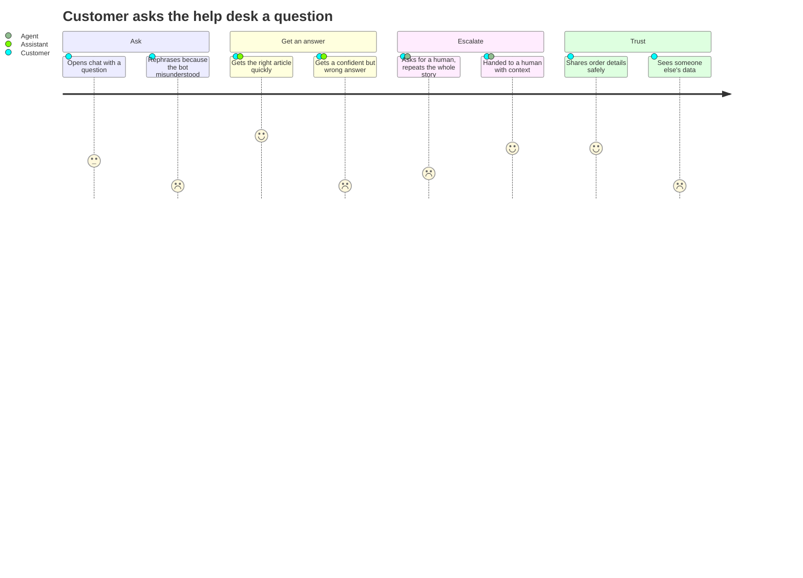

# Customer journey map

The project started from a journey map of a customer contacting an online store's help desk, built in Miro and summarized here. Scores are how the customer feels at each step (1 = frustrated, 5 = satisfied).

## Pain points that became backlog items

| Pain point | Backlog item |
|---|---|
| Bot doesn't understand everyday wording | Map customer vocabulary to article vocabulary |
| Confident wrong answers | Confidence gate with human handoff |
| Repeating the story to a human | Hand off with the conversation attached |
| Sensitive cases treated like routine ones | Policy rules that always route to a person |
| Fear of data leaks | Order ownership checks, injection blocking, PII redaction |
